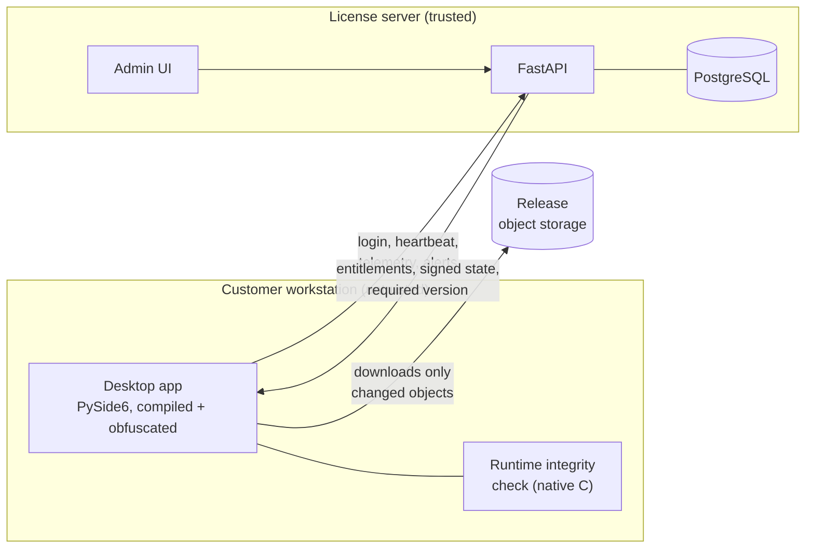

# CoDesignAI — Summer 2026 internship

> **CoDesignAI** is a startup affiliated with **Polytechnique Montréal**.
> Backend & security engineering intern, June to August 2026, Montréal.

This repository is a write-up of my three-month internship (June to August
2026) at **CoDesignAI**, a Polytechnique Montréal-affiliated startup. Its
product, also called CoDesignAI, is a subscription-based analog circuit
optimization tool that uses reinforcement learning and is installed on the
customer's own machines.

The product's source code is not here. It belongs to CoDesignAI and stays
private. What this repository covers is the problem, what I built, the
architecture decisions behind it and what I learned. CoDesignAI gave me
permission to publish it.

---

## The problem

CoDesignAI ships a compiled desktop client that runs on customer
workstations: shared lab machines, network mounts, users with root access.
The code runs on a machine the vendor does not control, which raises four
questions:

1. **Who is allowed to run the software**, on how many machines at once,
   with which features?
2. **How do we know if the installed binary has been tampered with?**
3. **How do we ship a new version** to every machine reliably, without
   resending 200 MB each time?
4. **How do we present the product** to the public?

I owned the backend and security side: the license server, runtime
integrity checking and the update system. Toward the end I also built the
company's website. The desktop GUI already existed when I joined; I wired it
into the new backend.

## What I built

| Area | Summary | Details |
|---|---|---|
| **Security proof of concept** | Defense-in-depth prototype: ECDSA P-256 signed licenses, Cython compilation, AST obfuscation, AES-256-GCM artifact encryption. | [docs/security-poc.md](docs/security-poc.md) |
| **License server** | FastAPI + PostgreSQL API: authentication, floating seats, per-module entitlements, heartbeat, telemetry, audit log, admin UI. | [docs/architecture.md](docs/architecture.md) |
| **Client integrity** | Runtime verification of the in-memory code (Merkle tree, native C library) and verification of installed files against a hash manifest. | [docs/security.md](docs/security.md) |
| **Delta updates** | Directory build, content-addressed objects, only changed files are downloaded, two-step release. | [docs/updates.md](docs/updates.md) |
| **Website** | Bilingual (EN/FR) site built with React 19, Vite and three.js: [codesignai.ca](https://codesignai.ca) | [docs/website.md](docs/website.md) |
| **Handover documentation** | Protocol-oriented READMEs, an operations guide, a scaling study and a security architecture document. | — |

## Overview

One principle shapes everything else: **the client is the sensor, the server
is the lock.** Anything running on the customer's machine can be bypassed by
someone who controls that machine. The client-side controls make cheap
attacks expensive and report what they see, but the only authoritative
decisions (refusing a session, withdrawing an entitlement) are made on the
server.

## Timeline

| When | Work |
|---|---|
| **Before the internship** | Security proof of concept. |
| **June** | Database schema, floating licenses, entitlement tokens, a first "drop & replace" updater. |
| **July** | GUI integration with the new backend (replacing Firebase), heartbeat, telemetry, remote global pause, admin UI and audit log. |
| **Mid-July to early August** | Runtime integrity checking: C library loaded through `ctypes`, Merkle tree over the code segment, continuous stealth scan. |
| **August** | External release storage, delta updates, an internal security audit with every finding fixed, handover documentation, final demo. |
| **Fall** | Company website, deployed on Render. |

## Stack

**Backend**: Python, FastAPI, SQLAlchemy (async, asyncpg), PostgreSQL,
APScheduler, JWT (HS256 and ES256), bcrypt, deployed on Render.

**Client**: Python, PySide6 / Qt (`QThread` workers), C (native library via
`ctypes`), PyArmor, PyInstaller, Cython.

**Delivery**: content-addressed object storage (Hugging Face Hub), shell
build and release scripts.

**Web**: React 19, TypeScript, Vite 6, React Router, three.js, Lenis.

## What I learned

- **Write down what a control does not stop.** Every security mechanism is
  documented with what it blocks *and* what it doesn't. Claiming a
  client-side check is unbreakable only fools yourself.
- **A false alarm can cost more than a missed detection.** Obfuscated builds
  are not byte-reproducible. Locking users out on a hash mismatch would have
  locked out paying customers after a routine republish. So that check
  alerts instead of locking, and the rule "a published version is never
  republished" is enforced by the tooling.
- **Fail-open versus fail-closed is a per-control decision.** A missing file
  is a real signal. A file that is briefly unreadable on a network mount is
  not.
- **Test the whole cycle, not just the unit.** Several updater bugs only
  showed up with a real compiled executable being killed, replaced and
  relaunched. The isolated tests passed.
- **A column in the model is not necessarily a column in the database.**
  `create_all()` creates missing tables but never alters existing ones.
  Schema changes have to be explicit.
- **Documentation is part of the deliverable.** The internship ended with a
  handover: READMEs organized around protocols rather than folders, an
  operations guide for the admin UI, and a measured estimate of what each
  client costs in requests and bytes.

## What is deliberately left out

The product is in production. So this repository contains no source code,
no hostnames, accounts or endpoints, no exact control parameters
(thresholds, intervals, sizes), no audit results or known limitations, and
no git history from the original repositories. It describes approaches, not
an implementation someone could target.
