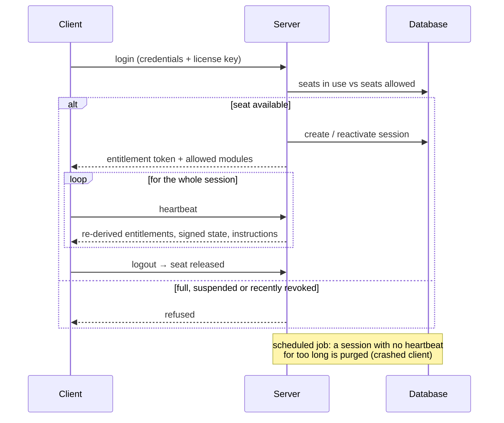

# License server

[← Back](../README.md)

The license server decides who may run the desktop client, on how many
machines at once, with which features and on which version. I took it from
prototype to the service that runs in production.

It is small on purpose: four routers, a service layer, one PostgreSQL
database, and an admin UI made of static HTML with no framework and no build
step. Most of the complexity is in neither the server nor the client: it
lives in the **protocols** between them.

## Layout

| Layer | Role |
|---|---|
| Routers | HTTP only: parse, authorize, call a service, shape the response. |
| Services | Every decision that matters (licenses, sessions, releases, audit, login throttling). |
| Models | SQLAlchemy tables: users, licenses, sessions, modules, plans, audit log, system state, release state… |
| Core | Settings, cryptography centralized in a single module, plan → module mapping, scheduled jobs. |
| Admin | Static pages: licenses, plans, messages broadcast to clients, usage statistics. |

Auto-generated API docs are disabled in production. Neither the client nor
the admin UI needs them, and they would publish the full route list.

## Floating licenses and seats

- **A seat is a session, not a machine.** The license caps *concurrent* use,
  so the session identifier is generated on every launch rather than derived
  from a hardware fingerprint. This was a deliberate change from my proof of
  concept, where the identifier was hardware-bound; the real requirement
  came out of discussions with the team.
- **The heartbeat is the only downstream channel.** The server cannot reach a
  client; it can only answer it. Every response carries entitlements
  re-derived from the database, a renewed token, and current instructions
  (global pause, admin message, revocation).
- **Seats held by crashed clients are reclaimed** by a scheduled job
  (APScheduler), with no manual intervention.
- **Revocation is durable.** Without a cooldown, a revoked user could log
  back in seconds later. Revocation is now recorded separately from the
  session status.

## Per-module entitlements

Premium features are granted per plan, and optionally per user. The client
keeps no list of entitlements it could edit: every time a feature is opened,
the server **re-derives** the entitlement from the database. Changing a plan
in the admin UI takes effect on the next heartbeat, with no redeploy and no
need for the user to log in again.

## Identity and cryptography

- Passwords are hashed with **bcrypt**. A login with an unknown email is
  checked against a dummy hash, so it takes as long as a wrong password.
  Response timing does not reveal which accounts exist.
- **Login throttling** at several scopes (per account, per source, and a
  stricter one for admin access), with a delay that grows on each failure,
  then a temporary lockout.
- **Several token classes** (entitlement, module, admin session), all signed
  server-side. Critical state sent to clients is signed with **ES256**: the
  client holds only the public key, which lets it verify but not forge.
- **Separated secrets**: each secret has a narrow role, so leaking one does
  not compromise the others. Secrets embedded in the client are assumed
  extractable by design and only grant minor privileges.
- **Admin UI**: the root key is used once, to obtain a short-lived signed
  session. The browser never stores it.

## Observability

Every admin action goes into an append-only audit log. Client integrity
alerts are reported to the server, including through a channel that does not
require a session: a tampered client may never manage to log in. Per-feature
usage statistics feed a dedicated admin page.

## Operations

At the end of the internship I wrote for the team:

- an **operations guide** for the admin UI. Every button sends a request to a
  process running on someone else's machine: nothing takes effect at the
  moment of the click, and some actions keep having effects after they have
  been undone;
- a **scaling study**: the measured cost of one client in requests and bytes,
  the capacity of the current deployment, and which hosting plan a given
  number of customers needs;
- **READMEs rewritten around protocols** rather than the folder layout, with
  diagrams that GitHub renders directly.
