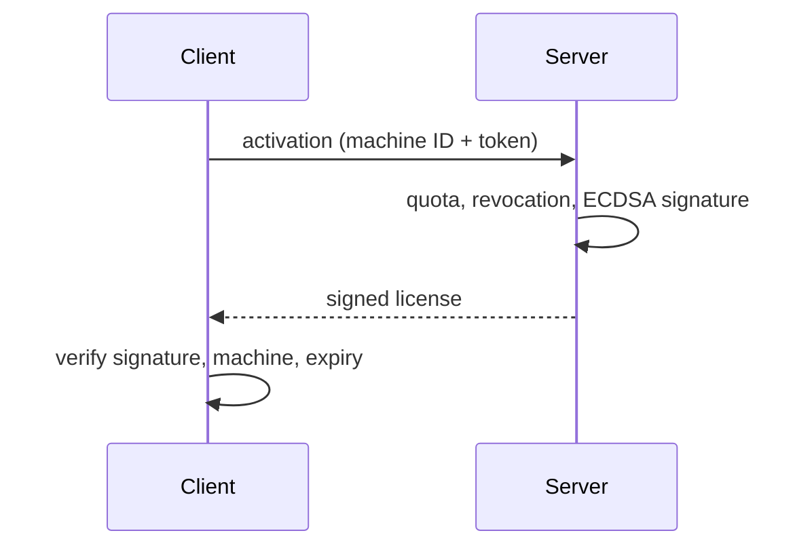

# Security proof of concept

[← Back](../README.md)

Before working on the product, I built a standalone proof of concept to
explore how to protect an optimization tool that is sold by subscription and
installed on the customer's machines.

## Threats

- Running the engine without a valid subscription.
- Handing the binary to a third party.
- Reverse-engineering the heuristics and model weights.

## What I explored

**Package separation.** The deliverable is split into layers of different
sensitivity: the UI, which holds no secrets; the engine, compiled and
encrypted; and the license control, compiled. Compromising one part does not
expose the whole.

**Asymmetric licenses (ECDSA P-256).** The server signs a license bound to
the machine and to an expiry date. The client embeds only the public key: it
can verify a license but cannot forge one. Later launches validate offline,
and revocation goes through an online check.

**Code protection.** Cython compilation into native libraries with stripped
symbols, preceded by AST-level obfuscation (identifier renaming, string
encryption).

**Artifact protection.** Weights and configuration encrypted with
AES-256-GCM, using a key derived through HKDF from machine-specific inputs.
An artifact copied to another machine cannot be decrypted there. A per-client
HMAC watermark makes it possible to trace the source of a leak.

**Debugger detection.** Checks at startup and on a background thread.

**Confidential computing (not implemented).** Hardware enclaves (SGX/TDX)
would release the key only after attesting the execution environment. Out of
scope, since it depends on the hardware.

## What made it into production

The main conclusion carried over to the product: **the authoritative check
has to be server-side.** Several choices also changed once the real
requirements were clear:

| POC | Production | Why |
|---|---|---|
| Hardware-bound license | Seat = concurrent session | The real need is to cap concurrent use, not machines. |
| Offline validation | Continuous heartbeat + grace period | To be able to revoke access mid-session. |
| Cython | PyArmor + directory build with PyInstaller | A directory build makes delta updates possible. |
| One-time check | Continuous in-memory integrity check | To also catch tampering done after launch. |

The proof-of-concept code is not published: some of its techniques were
carried into the product.
