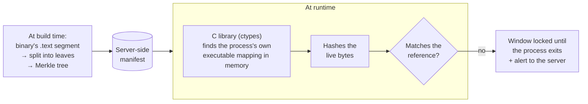

# Client security

[← Back](../README.md)

The desktop client runs on a machine the vendor does not control, where the
user has full privileges. I organized its security in layers, from the
outside in. Each layer is documented with what it stops **and what it does
not**.

Exact parameters (intervals, thresholds, sizes, digests) are left out: the
product is in production.

## The layers

| Layer | Approach | Posture |
|---|---|---|
| **Packaging** | First-party modules encrypted (PyArmor) before packaging (PyInstaller) | Deterrent |
| **Runtime integrity** | Merkle tree over the in-memory code, read by a native C library | Lock |
| **File integrity** | SHA-256 of every installed file, checked against a server-held manifest | Alert |
| **Identity** | bcrypt, signed tokens, login throttling | Server-side refusal |
| **Entitlements** | Re-derived from the database each time a feature is opened | Server-side refusal |
| **Liveness and seats** | Heartbeat, offline grace period, durable revocation | Forced quit |
| **Update channel** | Content-addressed objects, guards against malicious paths | Block |
| **Observability** | Audit log, integrity alerts | Record |

## Runtime integrity (RASP)

This was the most low-level part of the internship.

- It reads **the code in memory**, not the file on disk. An in-memory patch
  is detected even if the original file was restored afterwards.
- **One full scan at startup, then a stealth scan** that keeps re-checking a
  randomly chosen leaf. Each check costs a few microseconds, so the whole
  lifetime of the process is covered at no measurable cost.
- **The reference is served by the server**, never embedded in the binary.
  An attacker able to patch the code could also patch a local reference to
  match.
- **The lock lasts until the process exits.** Modified code can no longer be
  trusted, including for the login screen. Only a fresh process starts over.

**What it does not stop:** someone removing the verification call itself.
No client-side check survives that, and the documentation says so
explicitly. Coverage is also limited to the launcher's code, a small part of
the install. The next control covers the rest.

## Installed-file integrity

The update system already publishes a `{path, sha256, size}` manifest for
every shipped file. I reused it to verify the whole install at launch, then
a random sample of files at regular intervals. The reference is
server-side and version-pinned: nothing extra to generate at build time, and
no local file an attacker could edit in step with the files it describes.

**This check alerts, it does not lock.** Obfuscated builds are not
reproducible: the same source produces different binaries. If a version is
republished under the same number, every installed client sees its files
disagree with the manifest even though nothing was tampered with. Locking in
that case would have locked out paying customers. The rule we kept: a false
tamper alarm is worse than a missed check. The release tooling therefore
refuses to republish an existing version.

Failure cases are told apart precisely: a **missing** file is a real signal.
A file that is **briefly unreadable** (network mount, antivirus lock) is
not. A manifest without hashes is rejected, because a check that cannot
verify must not report that everything is fine.

## Internal audit

In August, an internal security review flagged several issues across the
client and the server. I fixed all of them in code before the end of the
internship. The details are not published here.
