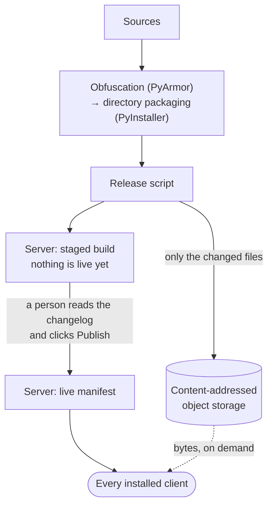

# Delta updates

[← Back](../README.md)

The update system was built in three stages over the internship.

1. **Drop & replace**: download a full executable, verify its SHA-256, then
   swap it in and relaunch the app through a detached script that deletes
   itself afterwards.
2. **External storage**: release bytes no longer go through the license
   server. The server states which version is current, then redirects the
   client to object storage. A release of several tens of MB costs the
   free-tier instance nothing.
3. **Delta**: the build switches from a single executable to a directory.
   Each file is stored under its hash, and a client only downloads the
   objects it does not already have.

## The pipeline

## The rules

- **Versions only go up.** A client updates only when the server's version
  is strictly higher than its own. A bad release is fixed by publishing the
  next one, never by rolling back. The release script checks this *before*
  the ten-minute compile, not after.
- **Never two builds for the same version number**, because builds are not
  byte-reproducible (see
  [security](security.md#installed-file-integrity)).
- **Releasing is a two-step process.** The script prepares everything and
  stops before the last step. Going live for every client is a human
  decision, made from the admin UI.
- **Mandatory by default.** An update is mandatory unless the person
  publishing it explicitly marks it optional. An optional update is only
  offered when it interrupts nothing: on the login screen, never during an
  optimization run. If the user declines, they are not asked again until the
  next launch.

## On the client

- The local install is analyzed: for each file, reuse the existing copy or
  download it.
- Each downloaded object is hash-checked, then the assembled directory is
  verified in full before anything is replaced. The double check is
  intentional: it costs a few seconds and avoids installing a half-corrupted
  update.
- Paths coming from the manifest are validated, so a malicious manifest
  cannot write outside the install directory.
- The full cycle (kill the process, replace, relaunch) was validated with
  real compiled executables. Two bugs only showed up under those conditions:
  a test that "passed" only because PySide6 was not installed, and a relaunch
  that never actually happened.
